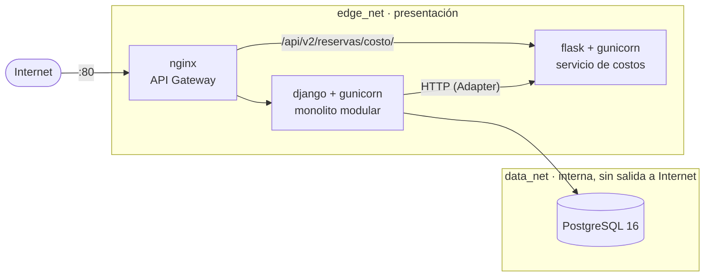
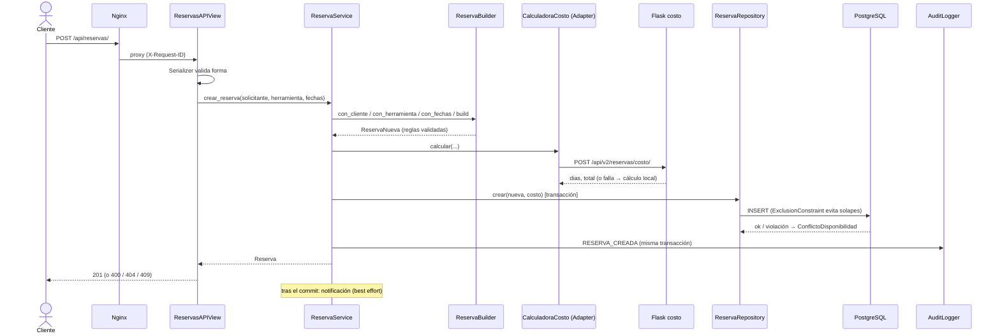

# Arquitectura de RentaTools

## 1. Vista de despliegue y redes (3 capas aisladas)



* Solo `nginx` publica un puerto (80). `db` y `costo` no son alcanzables desde fuera.
* `data_net` es `internal: true`: PostgreSQL no tiene ruta hacia Internet.
* Security Group en AWS: entrada TCP 80 pública; SSH (22) solo desde la IP del administrador.

## 2. Estructura interna de cada módulo (Clean/Hexagonal ligera)

```
apps/<modulo>/
  domain/           reglas de negocio puras (entidades, Builder). Sin Django.
  application/      servicios (casos de uso) + puertos (interfaces ABC). Sin Django.
  infrastructure/   adaptadores: repositorios ORM, cliente HTTP, Factory de notificadores.
  presentation/     serializers (solo forma/tipos) + APIView (solo HTTP).
  composition.py    único lugar que decide qué implementación concreta se inyecta.
  models.py         persistencia "delgada": campos y constraints de BD.
```

Regla de dependencias: `presentation → application → domain` y `infrastructure → application/domain`.
El dominio y la aplicación **nunca** importan Django.

### SOLID, dónde se ve

| Principio | Evidencia |
|---|---|
| **S**RP | View = HTTP · Serializer = forma · Service = orquestación · Builder = construir/validar · Repository = persistir · Calculadora = costo |
| **O**CP | `NotificadorFactory.registrar()` añade canales sin tocar código existente |
| **L**SP | `CostoHttpAdapter`, `CalculadoraLocal` y `CalculadoraConRespaldo` son intercambiables vía `CalculadoraCosto` |
| **I**SP | Puertos pequeños y específicos (`Notificador`, `CatalogoHerramientas`, `AuditLogger`…) |
| **D**IP | `ReservaService` recibe 7 abstracciones por constructor; las concretas se eligen en `composition.py` |

### Patrones
* **Builder** (`reservas/domain/reserva_builder.py`): construye y valida la `Reserva`, la entidad más compleja.
* **Factory** (`reservas/infrastructure/notificadores.py`): elige el notificador según `ENV_TYPE`.
* **Adapter** (`reservas/infrastructure/costo.py`): traduce el puerto `CalculadoraCosto` al contrato HTTP del microservicio.
* **Strangler Fig**: el cálculo de costo salió del monolito; Nginx enruta `/api/v2/reservas/costo/` al servicio Flask y el monolito conserva un respaldo local mientras se estabiliza.

## 3. Caso más complejo: crear una reserva



### Doble reserva: garantizada por la base de datos
`ExclusionConstraint(daterange(inicio, fin, '[]') && , herramienta =)` sobre reservas vigentes. Con dos
peticiones simultáneas PostgreSQL deja pasar una; la otra recibe `409 herramienta_no_disponible`
(verificado con una prueba de concurrencia real).

### Auditoría
Cada transacción relevante escribe un `RegistroAuditoria` (BD) + una línea JSON en stdout. Los rechazos
(400/404/409) también se auditan (`resultado=RECHAZADO`). La tabla es **inmutable** por un trigger de PostgreSQL.

## 4. Visión de API Gateway y escalabilidad
Nginx ya es el gateway: toda ruta pasa por él, aplica límites de tasa, cabeceras de seguridad y añade
`X-Request-ID`. Extraer otro módulo (p. ej. Pagos) = nuevo contenedor + un `location` en `nginx.conf`
+ reemplazar su adaptador en `composition.py`; los demás módulos no cambian.
