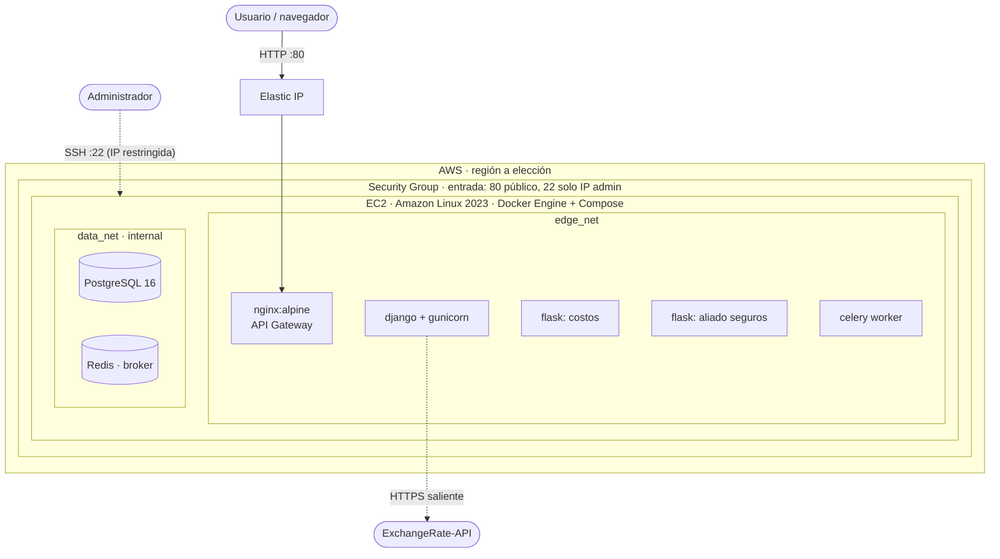
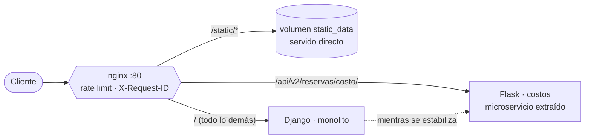
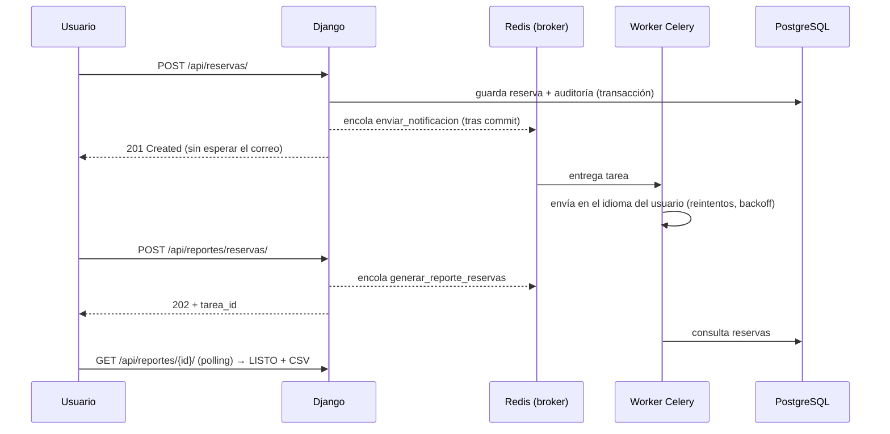

# Diagramas de arquitectura (Entrega 2)

## 1. Infraestructura AWS

## 2. Nginx como API Gateway (Strangler Fig)

Cuando otro módulo se extraiga, basta agregar un `location` nuevo: el cliente no cambia.

## 3. Servicios Flask (microservicios)

```mermaid
flowchart LR
    subgraph costo [Servicio de costos]
      R1[routes.py<br/>HTTP] --> S1[services.py<br/>reglas de cálculo]
    end
    subgraph aliado [Servicio ALIADO · seguros simulado]
      R2[POST /api/v1/seguros/cotizar<br/>X-API-Key] --> S2[prima = max&#40;2000, valor×tasa&#41; + 500×días]
    end
    M[Monolito Django] -- "Adapter CostoHttp" --> R1
    M -- "Adapter AliadoSeguros<br/>JSON + API key" --> R2
```

## 4. Message broker (Redis + Celery)

## 5. Flujo de servicios (rúbrica)
| Requisito | Dónde |
|---|---|
| Proveer endpoint JSON | `/api/...` del monolito y `/api/v2/reservas/costo/` (Flask) |
| Consumir servicio del aliado | `aliado_seguros.py` → servicio `aliado` |
| API de tercero con Adapter | `tasas_cambio.py` (ExchangeRate-API, caché y respaldo) |
